物品与背包功能

# 背包

### 配置相关

- 主要有两个表来配置
  - basicbag.yaml（可选）
    - 负责基础的背包逻辑，
  - bags.yaml
    - 用于配置不同背包的差异
- **bags.yaml不同背包配置**
  - id，int，作为区分不同背包的key
  - 特殊能力，int，对应的背包所持有的特殊能力，为空时则无能力。引用buff.yaml表，
  - 超重惩罚，int，对应超重惩罚，为空时无惩罚。引用buff.yaml表。
  - 模型，int（尚未实现），对应的静态模型id，为空时用图标代替。引用model.yaml表
  - 图标，string，为空时使用统一占位图。对应图标名。
  - 描述，string，为空时无描述。用于tips显示的简短描述

### 逻辑相关

- **basicbag.yaml背包通用逻辑**
  - 背包页签（即分类）
    - 暂时只有“全部”，“装备”，“道具”三种页签
    - 点击不同页签时做出对应筛选，并显示。在筛选时同步做出排序。
  - 背包列表
    - 可以上下滑动，做条状的滑条
    - 默认按照先按照物品种类排序。
      - 相同种类中，按照单位重量进行内部排序
    - 列表暂时不做最大条数上限，详见”**容量**“
  - 容量
    - 以总重量为容量上限，来控制背包的大小。堆叠详见下文
    - 不同背包容量相同，影响容量上限的应该是玩家的力量属性，而非背包本身的属性。
    - 背包超重时，玩家移速会降低，也可作为不同背包的差异点。

### 界面相关

- 参考：

- 按下B键可打开该界面。

- 此处将背包、装备栏一并显示，并且方便小队队员处理。

- **小队**

  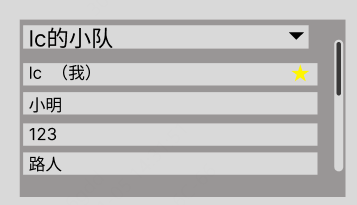

  - 上方是一个下拉的菜单，点击后打开，可切换小队

    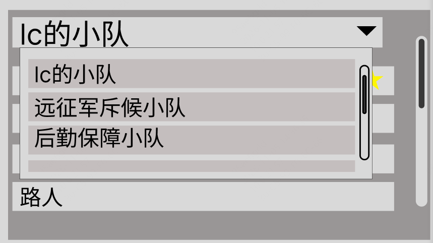

    - 此处支持玩家自定义小队名称。

  - 点击名字后可切换人物的信息和背包面板。详见下文。

  - 小队长默认显示在第一行，右侧以黄色星星作为标识。

- **背包**

  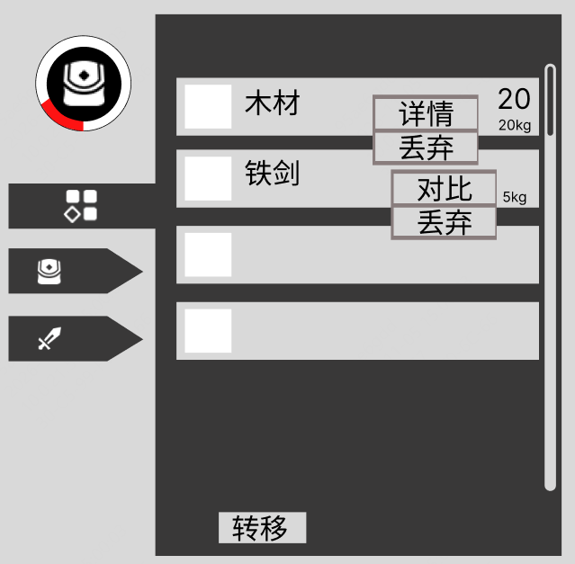

  - 背包标识与容量显示

    - 以颜色条块占比代表当前已占用的背包容量。
    - 可点击来更换背包。换下的背包默认掉落至世界中，其中的物品自动转移至当前背包中，若当前容量不足则直接掉落在世界中。

  - 页签

    - 默认状态下是收起状态
    - 点击后发生显示上的变化，来区分选中和未选中状态
    - 点击后打开相应的背包页。

  - 背包栏

    - 以列表条目的形式展示背包物品。

      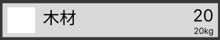

    - 包含图标、名称、数量文本和重量文本。

    - 允许左键长按拖动条目改变排序。

    - 对于道具，右键点击可打开小操作菜单

      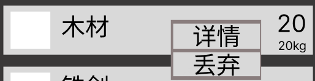

      - 此处先暂时不考虑礼包类型的可使用道具。

      - 点击详情，关闭小操作菜单，弹出该道具的tips窗口。

        

      - 点击丢弃，若堆叠数为1，则直接执行丢弃逻辑。若不为1，则弹出批量丢弃窗口，确定数量后执行丢弃。

      

    - 对于装备，右键点击打开小操作菜单

      - 点击对比，在右侧的装备栏会出现该装备的详情。详见装备栏。
      - 丢弃同道具丢弃逻辑。

    - “转移”按键：点击打开批量转移物品页面。此处功能应在单独文档中设计，不在此赘述。

- **人物基础信息**

  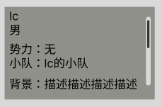

  - 名称、性别、势力等等。

- **人物属性信息**

  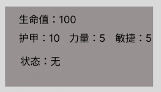

  - 显示当前各项数值。发生变化时更新显示。
  - 状态：默认无状态，此处指的是受伤、被俘等状态（待讨论）

- **人物模型展示**

  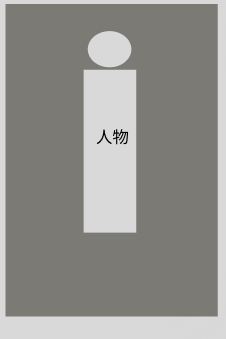

- **装备栏**

  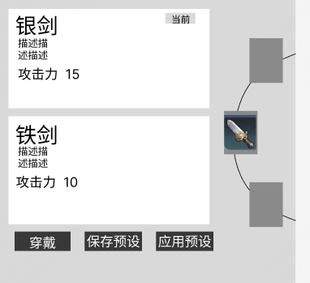

  - 左侧是展示区，上方展示当前穿戴的装备，下方为预览的装备。只能同时展示相同部位的装备。

    - 默认不打开展示窗。

      

    - 点击装备栏装备后打开其展示框。

      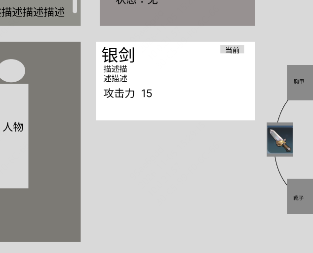

    - 从背包栏点击装备对比后，自动将该部位置中，打开对比窗口。

      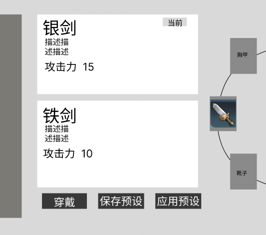

      - 若当前该部位无装备，则不显示上方的展示框。
      - 点击穿戴则执行穿戴逻辑。
      - 点击保存预设，将当前该人物的所有装备部位状态保存。
      - 点击应用预设，将自动应用最近一次保存的装备部位状态，快捷穿戴预设中的装备。

- 右侧是部位轮盘，点击上下两部位会将该部位置中，同时发生轮盘显示的更新，可循环显示

  示意：

  

- 栏目：有近战武器、远程武器、头盔、胸甲、靴子五个部位。

# 物品

### 配置相关

- 通过若干个yaml表配置
  - equipments.yaml
  - weapons.yaml
  - normal.yaml
- 物品暂时分为装备（包括武器）、道具两种大类

- 通用字段
  - id，int，唯一key
  - 图标，string，图标名
  - 种类，枚举，类型名
  - 重量，float，单位重量（g克）
  - 描述，string，用于tips显示的简短描述
  - 模型，int，物品模型。引用model.yaml表

### 物品出现方式

- 掉落

  - 敌人被击败、采集完成、场景预置或玩家主动丢弃时，可在指定世界坐标生成掉落物。具体产出由对应玩法配置。

  - 掉落物显示可辨认的模型或统一拾取标识；玩家进入拾取距离后可查看名称、数量和拾取提示。

  - 默认由玩家主动拾取。拟定拾取键为 F，距离为 2 米；存在多个候选时，先选择准星附近目标，再按距离和稳定编号确定唯一目标。不得隔墙拾取。

  - 一次拾取尽量收取目标物品组。容量不足时只收取可容纳的数量，剩余数量留在原位置；完全无法收取时提示背包已满。

  - 成功入包后才扣除对应掉落数量；减为零后移除世界掉落物。重复按键不能重复获得同一份物品。

  - 首版掉落物不按现实时间自动消失，离开视野不清除；世界卸载和读档需恢复未拾取部分。角色死亡掉落范围另由死亡规则决定。

- 发放：

  - 初始携带、任务奖励、对话赠送、购买和制作产出等均通过发放交付。交易与制作是业务来源，不增加第三种出现方式。

  - 发放对象必须是指定角色。物品直接进入其背包，不经过世界掉落物，也不因队伍关系自动分配给其他队员。

  - 一次发放先检查整批物品是否可容纳，足够才整体提交；不足则本次发放全部不执行，不自动改为地面掉落。

  - 任务奖励未成功交付时保持可领取；购买不得扣款，制作不得扣料。初始配置超容量时报告配置错误。

  - 同一奖励事件成功交付后标记已领取。刷新界面、重复点击或重新读档不能再次领取。
