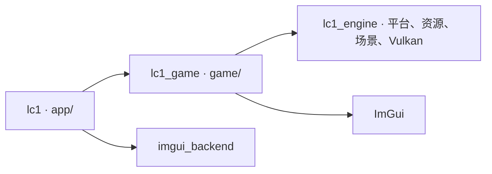
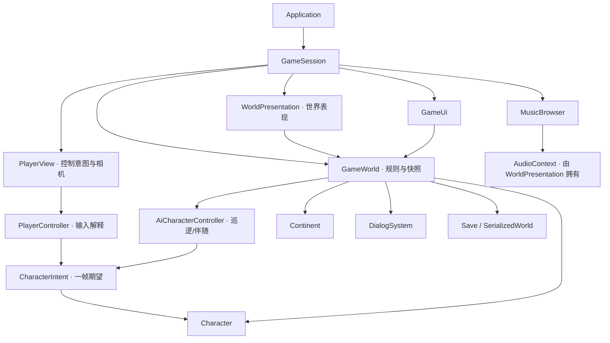
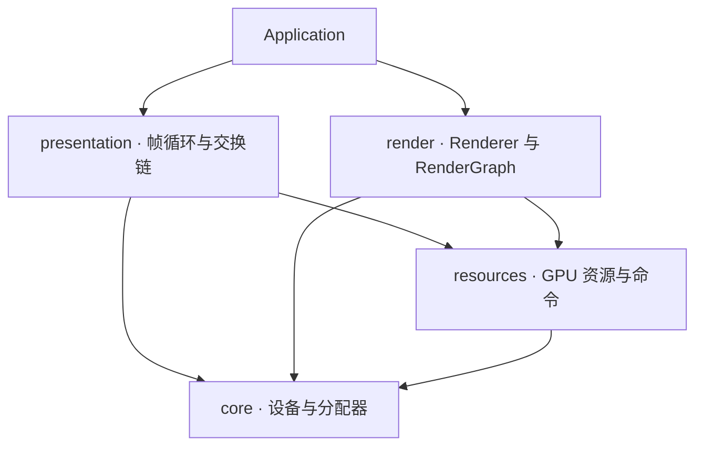

# 模块依赖图

本文帮助定位代码。箭头 `A → B` 表示 A 依赖 B，不表示所有权或调用顺序。
职责、每帧时序与生命周期以[代码边界](code-layout.md)为准；Vulkan 层内规则以[Vulkan 分层](vulkan-layers.md)为准。

## 构建目标

这是实际链接目标的简图，不是每个头文件的完整依赖图。规则与表现仍在同一个游戏库中；
能无窗口运行 CPU 测试，不代表已经有独立的无图形依赖构建目标。具体源文件与第三方链接见
[CMakeLists.txt](../CMakeLists.txt)，包配置见 [conanfile.py](../conanfile.py)。

## 本地会话

玩家和 AI 都只产生 `CharacterIntent`；`Character::update(delta, intent)` 决定能否执行、速度和
最终位置。`CompanionOrder` 是 `AiCharacterController` 的模式状态，由 `Party::command` 安装，
并由存档恢复；`Character` 只通过控制器查询它，不再自己实现跟随。世界不依赖
`PlayerController`，会话负责把玩家 intent 与输入门控一起交给世界。

游戏实现位于 `include/lc1/game/` 与 `src/game/`，按 `character/`、`player/`、`world/`、
`continent/`、`party/`、`dialog/`、`session/`、`ui/`、`camera/` 功能域组织。
`game/actions.*` 是游戏动作层，`lc1/input.hpp` 是设备/模板路由层。
输入解析、更新顺序以及对象间借用见[代码边界](code-layout.md)；角色、对话、存档分别由
[角色](character.md)、[对话](dialog.md)、[存档](save-data.md)文档说明。网络架构是未来方向，
图中均为本地原型对象。

## 渲染与呈现

呈现与渲染由 Application 组合，不互相依赖。四层目前同属 `lc1_engine`，目录与头文件根目录
没有提供独立构建隔离。通道执行关系见 [RenderGraph](render-graph.md)，不是上述模块依赖箭头。

## 容易误读的边界

- `Model` 同时包含 CPU 导入和 GPU 上传入口，不能视作纯 CPU 模块。
- `scene::Transform` 与相机可以用于 CPU 逻辑；`scene::Object` 则借用 GPU 网格与材质并生成 `DrawItem`。
  因此整个 `scene/` 不是无渲染依赖的数据层。
- 主游戏循环与离屏录制统一通过 `scene::Scene` 借用视图向 Renderer 提供相机、灯光和绘制列表。
  `Model` 保存模型内部层级，`ModelInstance` 保存独立姿态；WorldPresentation 的占位角色已使用实例，
  节点动画和多网格绘制已接通，世界场景图与骨骼蒙皮尚未实现，详见[模型资源与实例](resources.md#模型资源与实例)。
- `ResourceManager` 已编入引擎，但当前游戏资源由表现对象直接构造；它不是现行统一加载入口。

构建、生成 shader、复制运行数据和测试的操作见[构建指南](../BUILD.zh-cn.md)；
地图离线生成链见[地图工具](map/README.md)。完整专题入口见[文档导航](README.md)。
